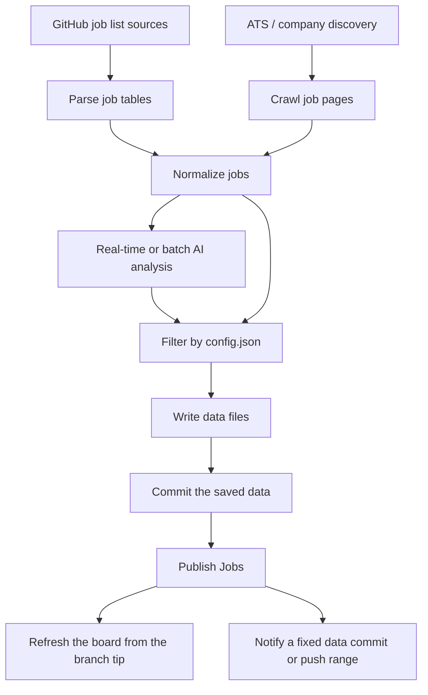

# Installation Guide

This guide explains how to set up **JobRadar-AI** from the template repository, configure it with the GitHub issue form, add required secrets, verify the setup, and understand how the scheduled workflows run.

JobRadar-AI is designed as a **self-hosted GitHub Actions workflow**. Your copy of the repository runs in your own GitHub account, uses your own email sender, and calls your own AI API key when AI analysis is enabled.

---

## 0. What you are installing

At a high level, JobRadar-AI does this:



The important pieces are:

- `config.json` controls target roles, countries, keywords, AI provider/model, SMTP sender, and receiver emails.
- GitHub Actions runs Jobs Pipeline, Batch Pipeline, and Maintenance on a schedule.
- Newly discovered jobs are committed into `data/`.
- Titles that match your notify config are analyzed in real time. Unspecified-level titles go through cheaper batch analysis.
- Publish Jobs refreshes the README board from the latest branch data and sends mail for one saved data commit, or for the before..after range of a direct push.

---

## 1. Create your own repository from the template

1. Open the original JobRadar-AI repository.
2. Click **Use this template**.
3. Choose **Create a new repository**.
4. Name your repository.
5. Choose **Public** or **Private**.

> Public repositories are easier for GitHub Actions usage because standard GitHub-hosted runners are free for public repositories. Private repositories may use your account's included GitHub Actions minutes.

Template repositories copy files, not your personal GitHub settings or secrets. After creating your repository, you still need to add secrets and run the setup flow below.

---

## 2. Enable GitHub Actions

In your new repository:

1. Go to **Actions**.
2. If GitHub asks you to enable workflows, click **I understand my workflows, go ahead and enable them**.

---

## 3. Add the bootstrap secret: `PAT`

JobRadar-AI commits generated config and job data back to your repository. A Personal Access Token is used for those pushes.

In your repository:

1. Go to **Settings → Secrets and variables → Actions**.
2. Click **New repository secret**.
3. Add:

```text
PAT=<your GitHub Personal Access Token>
```

### PAT permissions

Use a fine-grained token scoped to this repository only, and grant:

- **Contents: Read and write**

Issue comments and issue closing use the built-in `GITHUB_TOKEN`, so the PAT does not need Issues permission.

The PAT is required, not optional. Commits pushed with the default `GITHUB_TOKEN` do not trigger other workflows, so data commits must be pushed with the PAT. Jobs, Batch, Add Job, and Maintenance then call **Publish Jobs** for the commit they saved. A direct push of config or job data starts **Publish data changes**. The batch checkpoint commit contains `[skip ci]`, so that push does not start another workflow; the same Batch run publishes it.

> Every workflow checks out the repository with `secrets.PAT`, including `.github/workflows/setup-from-issue.yml`, so add `PAT` before opening the setup issue.

---

## 4. Open the setup issue form

Now create the setup issue:

1. Go to **Issues**.
2. Click **New issue**.
3. Choose **Setup JobRadar-AI**.
4. Fill out the form.

The setup issue form generates your `config.json`.

### What each field means

#### Internship targets

Select internship categories to track:

- `summer intern`
- `off-season intern`

#### Full-time targets

Select full-time categories to track:

- `entry level`
- `mid level`
- `senior level`

#### Countries

Select the countries or regions you want to track.

Example:

```text
USA
Canada
Remote
```

#### Eligibility filters

These filters apply to every selected country.

```json
"filter": {
  "USA": {
    "allow_citizenship_required": false,
    "allow_no_sponsorship": false
  }
}
```

Recommended for many international students targeting U.S. roles:

```text
Allow citizenship-required jobs? false
Allow jobs without sponsorship? false
```

That means:

- Exclude jobs that require citizenship.
- Exclude jobs that do not offer sponsorship.

If you want to see more jobs and filter manually later, set one or both options to `true`.

#### Keywords

Use one keyword per line.

The default list is focused on software engineering roles, including:

```text
software
backend
frontend
full-stack
platform
web
mobile
ai
cloud
infra
swe
sde
ui
ux
```

#### Priority keywords

Use one keyword per line. These outrank exclude keywords.

A title that contains `software` is kept even when it also says `hardware`, such as `Software Engineering Intern – AI Tools for Hardware Engineering`.

```text
software
swe
```

#### Exclude keywords

Use one keyword per line. These words drop a title unless a priority keyword is also present.

Matching is case-insensitive and whole-word, so `hardware` drops `Hardware Systems Engineer` and `Backend Engineer, Hardware`, and keeps a title that contains `software`.

```text
hardware
firmware
mechanical
electrical
pcb
asic
fpga
```

#### AI enabled

Check **Enable AI JD analysis** if you want JobRadar-AI to send crawled job descriptions to the configured AI model.

If AI is disabled:

- `AI_API_KEY` is not required.
- JD analysis will be skipped.
- Filtering may rely more on parsed job list metadata.

#### AI provider and model

Supported provider values in the setup form:

```text
google
anthropic
openai
```

Default model:

```text
gemini-2.5-flash
```

#### Email sender

For Gmail SMTP, use:

```text
SMTP host: smtp.gmail.com
SMTP port: 587
```

The sender email is the account that sends job alerts.

#### Email receivers

Receiver emails are where job alerts are sent. You can list more than one address.

You can use the same email for sender and a receiver, but using a separate sender account is cleaner.

---

## 5. Wait for `config.json` to be generated

After you submit the setup issue, this workflow runs:

```text
.github/workflows/setup-from-issue.yml
```

It does the following:

1. Parses the issue form body.
2. Runs:

```bash
pnpm jobctl setup get-config
```

3. Generates `config.json`.
4. Commits `config.json` to `main`.
5. Comments on the setup issue with the next steps.

If the issue does not trigger anything, check:

- GitHub Actions are enabled.
- The issue has the `setup` label, or the title starts with `Setup JobRadar-AI`.
- The `PAT` secret exists.
- The workflow run logs under **Actions → Setup from Issue**.

---

## 6. Add email and AI secrets

After `config.json` is generated, add the runtime secrets.

Go to:

```text
Settings → Secrets and variables → Actions
```

Add:

```text
SMTP_PASS=<your SMTP password or Gmail App Password>
AI_API_KEY=<your AI provider API key, only required if AI is enabled>
```

`PAT` should already exist from step 3.

### Gmail App Password

If you use Gmail, do not use your normal Gmail password.

Use a **Gmail App Password**:

1. Enable 2-Step Verification on your Google account.
2. Create an App Password.
3. Save it as the `SMTP_PASS` secret.

If SMTP validation fails with an authentication error, the most common causes are:

- 2FA is not enabled.
- You used your normal Gmail password instead of an App Password.
- The SMTP user does not match the sender account.

---

## 7. Verify setup with `/check-setup`

Return to the setup issue and comment:

```text
/check-setup
```

This triggers:

```text
.github/workflows/check-setup.yml
```

The check workflow runs:

```bash
pnpm jobctl setup check-config
```

It validates:

- `config.json`
- SMTP config
- `SMTP_PASS`
- `PAT`
- AI provider and model, if AI is enabled
- `AI_API_KEY`, if AI is enabled

If the check passes, the bot comments on the issue and closes it.

If the check fails, the bot comments with common failure reasons. Fix the issue, then comment again:

```text
/check-setup
```

---

## 8. Run the workflows manually once

After setup passes, run these workflows manually once from the **Actions** tab.

### Jobs Pipeline

Workflow file:

```text
.github/workflows/jobs.yml
```

Manual run:

```text
Actions → Jobs Pipeline → Run workflow
```

Choose `sync` or `scan`.

`sync` runs `pnpm jobctl sync`. It parses community-maintained GitHub job lists and commits new job data if anything changed.

`scan` runs `pnpm jobctl scan`. It discovers jobs from supported ATS/company sources. A manual scan looks back 2 days.

When the saved commit changes data, the same runner publishes that commit. A run that finds nothing succeeds and skips publish. The scheduled gate does not install dependencies.

### Batch Pipeline

Workflow file:

```text
.github/workflows/batch.yml
```

Manual run:

```text
Actions → Batch Pipeline → Run workflow
```

The workflow has two data commits:

1. `pnpm jobctl batch --submit-only` submits queued job descriptions to the provider Batch API (about 50% of real-time cost). It can also save results that were already inflight. That commit is `chore(batch): checkpoint inflight submissions [skip ci]`.
2. `pnpm jobctl batch` polls the provider every 20 seconds until those jobs finish or the 20-minute soft deadline is hit, then commits `chore(batch): collect batch analysis` when the collect step changes data.

`[skip ci]` keeps the checkpoint push from starting Publish data changes or another Batch run. Publish of the checkpoint does not wait for collect. If collect later changes nothing, or the collect job fails, jobs written by the checkpoint still go through Publish Jobs. Collect publishes its own commit only when that commit changes board or job files.

Notify still follows `config.json`. In the default hybrid setup, this queue is unspecified-level titles. Notify titles stay on the real-time path.

### Publish Jobs

Workflow file:

```text
.github/workflows/publish-jobs.yml
```

Manual runs use `publish-jobs.yml`. Jobs, Batch, Add Job, and Publish data changes call the same `.github/actions/publish-saved` action on their own runner.

The board step fast-forwards to the branch tip and runs:

```bash
pnpm jobctl board refresh
```

It commits `README.md`, `job-postings/`, and `assets/featured-badges/` when those files change. The board always renders the latest data on the branch, including a commit that landed after the data commit being notified.

The notify step uses a fixed range and does not check out that commit:

```bash
pnpm jobctl notify commit <data-sha>
pnpm jobctl notify range <from-sha> <to-sha>
```

Pipelines pass the data commit they just saved, so notify uses `notify commit`. A direct push passes the same before and after SHAs used to decide that the push contains jobs, so notify uses `notify range`. An empty `from-sha` keeps the single-commit command. A board failure still sends that notification and fails the workflow.

### Publish data changes

Workflow file:

```text
.github/workflows/publish-data.yml
```

This runs on a direct push of:

```text
config.json
data/jobs.ndjson
data/opportunities.ndjson
data/archive/opportunities-*.ndjson
src/modules/board/**
```

It skips a push whose commits were already published by Jobs, Batch, or Add Job. For every other push, the file check and the notification use one range:

- A push to an existing branch uses `github.event.before` and `github.sha`. A push that adds jobs in an earlier commit and only changes config in the last commit still notifies those jobs. This is the range Publish data changes uses for the repository's data branch, and it stays complete when the webhook commit list is truncated.
- A new branch reports an all-zero `before`. GitHub Actions receives the push webhook. That `commits` array holds at most 2048 commits. The older limit of 20 applies to the Events API timeline, not to this workflow payload. An empty list added no commits, so nothing is notified. A shorter list is the whole push: the range starts at the parent of its oldest commit, or the empty tree when that commit is a root. A list of 2048 commits may omit older commits, so the workflow fails and does not send mail from the truncated list.

### Add Job From Issue

Workflow file:

```text
.github/workflows/add-job-from-issue.yml
```

This workflow runs when an issue is opened or edited with the `add-job` label, or with a title that starts with `Add Job`. Use the **Add Job** issue form to submit one posting by company, role, link, and location.

It runs:

```bash
pnpm tsx scripts/github/add-job-from-issue.ts
```

It fetches the job description, analyzes it with your AI key, commits the job data, and calls Publish Jobs for that commit. The workflow comments on and closes the issue when publish succeeds. A failed publish leaves the issue open.

### Maintenance

Workflow file:

```text
.github/workflows/maintenance.yml
```

Manual run:

```text
Actions → Maintenance → Run workflow
```

Choose `clean`, `dedup`, `company refresh`, or `board refresh`. The scheduled run is always `clean`.

`clean` runs `pnpm jobctl job clean`. It checks every stored posting URL, removes postings that are gone from `data/urls.json`, and refreshes expiry in the opportunity data. Expired rows last seen more than 90 days ago are removed. A data commit from this workflow is published by the following push, through Publish data changes.

---

## 9. Workflow schedule and frequency

GitHub cron schedules use **UTC**.

### Jobs Pipeline

File:

```text
.github/workflows/jobs.yml
```

Sync schedule:

```yaml
schedule:
  - cron: "*/20 14-23 * * *"
  - cron: "*/20 0-7 * * *"
```

These windows cover 07:00–23:40 California time in both PST and PDT. The gate checks the hour in `America/Los_Angeles` and skips sync runs outside that window, so community sync runs every 20 minutes during the California day. Manual runs skip this check.

Scan schedule:

```yaml
schedule:
  - cron: "10 7-23 * * 1"
  - cron: "10 8-23 * * 2-5"
  - cron: "10 0-7 * * 2-6"
```

Scan runs once per hour at minute 10, between the sync runs at :00, :20, and :40. The three lines cover every California weekday hour in both PST and PDT. The gate skips runs that land on a California weekend.

Discovery looks back 2 days by default. The Monday 00:00 California run looks back 3 days to catch weekend postings. The workflow passes this to the scan as `DISCOVERY_LOOKBACK_DAYS`.

To reduce cost or email frequency, slow the matching cron in `jobs.yml`. For example, once per day at 13:00 UTC is `0 13 * * *`, and every 4 hours is `0 */4 * * *`.

### Batch Pipeline

Files:

```text
.github/actions/batch-work/action.yml
.github/workflows/batch.yml
```

`batch-work` is the shared implementation. Jobs Pipeline and Add Job From Issue run it in the same job that wrote the queue. `batch.yml` is the manual run and the hourly recovery. It holds `job-data-sync`, so it cannot write data while another data workflow is running. The steps do not take that lock a second time.

```yaml
on:
  schedule:
    - cron: "47 * * * *"
  workflow_dispatch: {}
```

A commit that only adds `data/batch/queue.ndjson` does not start another batch. Scan, sync, and an accepted issue process that queue once. `jobctl job analyze`, or a queue committed outside those workflows, waits for the hourly run or a manual Batch Pipeline run. Public JD sync writes `data/upstream/queue.json` and does not use this queue.

Submit checkpoints inflight work with `[skip ci]`, then collect polls the provider every 20 seconds until the batch finishes or the 20-minute soft deadline is hit. Checkpoint and collect each publish their own saved commit. A board failure still notifies that commit and fails the publish workflow. Collect continues after a failed or skipped checkpoint publish.

The shared gate reads `data/batch/queue.ndjson` and `data/batch/inflight.json`. A manual run uses this same check. A queue line or an inflight entry runs submit, collect, and their publishes. When both are empty, those steps are skipped and the caller stays successful. Existing inflight work is collected instead of submitted again. A failed batch fails the Jobs or issue workflow. A failed checkpoint publish still notifies that commit, still collects, and then fails the run.

### Publish data changes and Publish Jobs

Publish data changes is the push entry for direct edits. Publish Jobs is the shared board and notify workflow. Set `dashboard.notify` to `false` to skip mail. The public board does that. Template installs omit the field and still send mail.

The board uses the branch tip. Notification uses the saved data commit for a pipeline, or the before..after range for a direct push.

### Maintenance

File:

```text
.github/workflows/maintenance.yml
```

Current schedule:

```yaml
schedule:
  - cron: "0 0 */14 * *"
```

This runs `clean` at 00:00 UTC on days 1, 15, and 29 of each month. It can take up to 120 minutes because it checks every stored URL. Manual runs can choose another task.

### Which runs can be merged

Jobs, Batch, Maintenance, Add Job, Setup, and Publish data changes share the concurrency group `job-data-sync` with `cancel-in-progress: false` and `queue: max`. GitHub's default queue keeps one pending run and cancels the previous pending run. `queue: max` keeps up to 100 pending runs and starts them in order. The 101st pending run is still cancelled.

These must run one by one. A later event must not replace one that is still waiting:

- Add Job From Issue, because each issue writes its own job.
- Setup from Issue, because each edit writes config.
- Maintenance, because a waiting clean and a waiting dedup are different tasks.
- Publish data changes, because each push has its own before and after.

A later scheduled Jobs, Batch, or Maintenance run could stand in for an older scheduled run that has not started, because it reads the current sources. Those schedules still wait in this same queue, so a schedule cannot cancel a waiting issue, maintenance, or data-publish run.

Publish and batch steps run inside the workflow that already holds this group. They do not start another workflow with the same group. Manual Publish Jobs has no concurrency group. Check Setup only comments on an issue, and CI uses a separate group.

### A run that finds nothing

When Jobs or Batch finds no data to commit, that job succeeds and skips Publish Jobs. The Actions run stays successful. It is not cancelled.

---

## 10. Cost expectations

There are three possible cost areas:

1. GitHub Actions
2. AI API usage
3. Email sending

### GitHub Actions cost

For public repositories, standard GitHub-hosted runners are generally free. For private repositories, GitHub Actions uses your account's included minutes and may bill beyond those included minutes.

To reduce Actions usage:

- Make the repository public if appropriate.
- Reduce cron frequency.
- Disable workflows you do not need.
- Run manually instead of scheduled.

Official reference:

- https://docs.github.com/en/actions/concepts/billing-and-usage

### AI API cost

AI cost depends on:

- Number of job descriptions analyzed
- Average JD length
- Output size
- Selected model
- Whether AI is enabled
- Whether a job used real-time analysis or the cheaper Batch API (about 50% of real-time price)

The default model in the issue form is:

```text
gemini-2.5-flash
```

Prices and model availability change. Check the provider pricing page before relying on these numbers, and confirm the default model is still offered.

At the time of writing, Google's pricing page listed Gemini 2.5 Flash Standard text/image/video pricing at:

```text
Input:  $0.30 / 1M tokens
Output: $2.50 / 1M tokens
```

Gemini 2.5 Flash-Lite is cheaper:

```text
Input:  $0.10 / 1M tokens
Output: $0.40 / 1M tokens
```

Official reference:

- https://ai.google.dev/gemini-api/docs/pricing

#### Rough estimate

Use this formula:

```text
cost_per_job =
  input_tokens / 1,000,000 * input_price
  +
  output_tokens / 1,000,000 * output_price
```

Example using Gemini 2.5 Flash:

```text
Input tokens per JD:  5,000
Output tokens per JD:   500

Input cost:  5,000 / 1,000,000 * $0.30 = $0.0015
Output cost:   500 / 1,000,000 * $2.50 = $0.00125

Estimated cost per JD: about $0.00275
```

Approximate cost:

| Jobs analyzed | Approx cost |
| ------------: | ----------: |
|      100 jobs |      ~$0.28 |
|    1,000 jobs |      ~$2.75 |
|   10,000 jobs |     ~$27.50 |

This is only a rough estimate. Actual cost may vary based on prompt size, JD length, model, provider, retries, and pricing changes.

To reduce AI cost:

- Disable AI analysis.
- Use a cheaper model such as `gemini-2.5-flash-lite`.
- Narrow countries and keywords.
- Reduce schedule frequency.
- Avoid reprocessing the same jobs.
- Monitor your AI provider billing dashboard.

### Anthropic and OpenAI

The setup form supports `anthropic` and `openai`, but pricing depends on the specific model name you choose.

Official references:

- Anthropic pricing: https://platform.claude.com/docs/en/about-claude/pricing
- OpenAI pricing: https://developers.openai.com/api/docs/pricing

### Email sending cost and limits

Gmail SMTP itself is usually free, but Gmail is not designed for high-volume bulk email.

For personal use, this project should usually stay low-volume because it sends alerts to your own receiver emails.

If you plan to send alerts to many subscribers, use a dedicated email service such as Amazon SES, SendGrid, Mailgun, or Resend instead of Gmail SMTP.

Official Gmail sender guidance:

- https://support.google.com/mail/answer/81126

---

## 11. Updating configuration later

To change your setup, you have two options.

### Option A: Edit `config.json` manually

Edit:

```text
config.json
```

Then commit the change.

After editing, run:

```bash
pnpm jobctl setup check-config
```

Or comment in the setup issue:

```text
/check-setup
```

### Option B: Re-open or edit the setup issue

You can edit the setup issue form and save it again.

The setup workflow listens to:

```yaml
issues:
  types: [opened, edited]
```

If the issue still has the `setup` label or title, the workflow can regenerate `config.json`.

---

## 12. Template updates vs forks

Using **Use this template** gives you your own independent copy.

That is good for easy setup, but it means:

- Future changes in the original JobRadar-AI repository are not automatically applied.
- New features such as new parsers or custom domain support may require manually copying files or recreating your repository from the latest template.

If you want to track upstream changes more closely, use a fork instead of a template, but expect more Git/GitHub complexity.

Recommended for most users:

```text
Use this template
```

Recommended for contributors or advanced users:

```text
Fork
```

---

## 13. Troubleshooting

### Setup issue does not generate `config.json`

Check:

- Actions are enabled.
- `PAT` is configured.
- The issue has the `setup` label or title starts with `Setup JobRadar-AI`.
- The workflow logs under **Actions → Setup from Issue**.

### `/check-setup` does nothing

Check:

- You commented on the setup issue, not a pull request.
- The comment contains:

```text
/check-setup
```

- The issue has the `setup` label or title starts with `Setup JobRadar-AI`.

### Missing `PAT`

Add a repository secret:

```text
PAT=<your GitHub Personal Access Token>
```

### Missing `SMTP_PASS`

Add a repository secret:

```text
SMTP_PASS=<your SMTP password or Gmail App Password>
```

### Missing `AI_API_KEY`

If AI is enabled, add:

```text
AI_API_KEY=<your API key>
```

If you do not want to use AI, disable AI in `config.json`:

```json
"ai": {
  "enabled": false
}
```

### SMTP login failed

For Gmail:

- Use an App Password.
- Make sure 2-Step Verification is enabled.
- Make sure `sender.user` matches the Gmail account.
- Make sure `sender.host` is `smtp.gmail.com`.
- Make sure `sender.port` is `587`.

### No jobs are emailed

Possible reasons:

- No new matching jobs were found.
- Jobs were already sent before.
- Your filters are too strict.
- The sync workflow did not produce changes in `data/`.
- Publish data changes did not run because the push did not change `data/jobs.ndjson`, or the commit was already published by Jobs, Batch, or Add Job.
- The checkpoint commit contains `[skip ci]`. Its jobs are published by the Batch run that created it, not by the checkpoint push.
- The data commit was pushed without the `PAT`, so downstream workflows did not start.
- `dashboard.notify` is set to `false` in `config.json`.

### A run that finds nothing

Jobs and Batch succeed and skip Publish Jobs when they have no data commit. That success is expected. A cancelled run is a concurrency cancellation, not the empty-result path.

### Workflows skip outside certain hours

Sync only runs 07:00–23:40 California time, and scan only runs on California weekdays. Use **Run workflow** on Jobs Pipeline to run either task at any time.

### AI cost is higher than expected

Try:

- Disable AI.
- Use `gemini-2.5-flash-lite`.
- Reduce cron frequency.
- Reduce target countries.
- Reduce keywords.
- Check provider dashboard usage.
- Confirm non-notify titles are going through `pnpm jobctl batch` instead of real-time analysis.

---

## 14. Local commands

Prerequisites:

- Node.js 22 (`.nvmrc` pins `22.22.3`)
- pnpm 11.7.0

Install dependencies:

```bash
pnpm install
```

Create a `.env` file in the repository root. It is gitignored.

```text
SMTP_PASS=<your SMTP password or Gmail App Password>
AI_API_KEY=<your AI provider API key>
PAT=<your GitHub Personal Access Token>
```

`sync`, `scan`, and `batch` run the config check first and exit if any required value is missing.

Check config locally:

```bash
pnpm jobctl setup check-config
```

Generate config from an issue body locally:

```bash
ISSUE_BODY="$(cat issue-body.md)" pnpm jobctl setup get-config
```

Sync community sources:

```bash
pnpm jobctl sync
```

Run ATS discovery:

```bash
pnpm jobctl scan
```

Collect and submit batch analysis:

```bash
pnpm jobctl batch
```

Submit queued jobs without waiting for results:

```bash
pnpm jobctl batch --submit-only
```

A batch job whose AI answer breaks the JD rules gets up to 3 attempts in total. Without a provider Batch API, each failed real-time call counts the same way. Every attempt and its cost is kept in `data/batch/failures.ndjson`. After the third, the job is set aside there with `status: "failed"`. Queue those jobs again with 3 new attempts and run the batch:

```bash
pnpm jobctl batch --retry-failed
```

Send notifications:

```bash
pnpm jobctl notify latest
pnpm jobctl notify commit <commit-sha>
pnpm jobctl notify range <from-sha> <to-sha>
```

Refresh the job board:

```bash
pnpm jobctl board refresh
```

Preview email:

```bash
pnpm jobctl email preview
```

Maintain job data:

```bash
pnpm jobctl job add
pnpm jobctl job add -l <url>
pnpm jobctl job analyze -l <url>
pnpm jobctl job delete -l <url>
pnpm jobctl job clean
pnpm jobctl job dedup
pnpm jobctl company refresh
pnpm jobctl board refresh
```

Test and typecheck:

```bash
pnpm test
pnpm typecheck
```

---

## 15. Recommended first-run checklist

- [ ] Created repository from template
- [ ] Enabled GitHub Actions
- [ ] Added `PAT`
- [ ] Opened setup issue
- [ ] Confirmed `config.json` was committed
- [ ] Added `SMTP_PASS`
- [ ] Added `AI_API_KEY` if AI is enabled
- [ ] Commented `/check-setup`
- [ ] Setup issue closed successfully
- [ ] Manually ran Jobs Pipeline `sync` once
- [ ] Manually ran Jobs Pipeline `scan` once
- [ ] Manually ran Batch Pipeline once
- [ ] Confirmed notification email works
- [ ] Decided whether to keep **Add Job From Issue** enabled (see `SECURITY.md` for public repositories)
